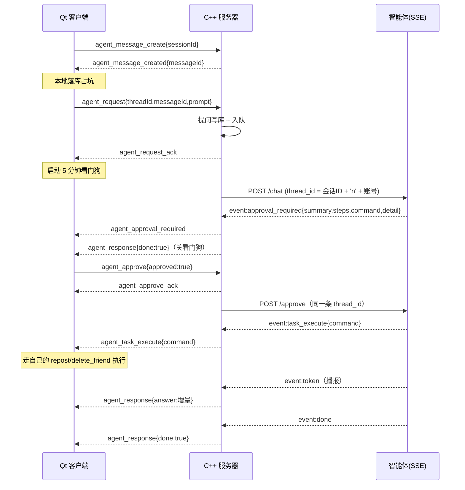

# 智能体后端（Supervisor 多专家路由 + HITL 审批）

本目录是 Qt 桌面软件内嵌智能体的 Python 服务端。它以 **FastAPI + SSE** 向前端推送流式数据，
内部由 **LangGraph** 编排「路由 → 专家 → 审批」的多智能体图，会话状态由 **SQLite checkpointer**
持久化，因此审批可以跨请求、跨重启续跑。

---

## 1. 架构

```
                                    ┌──────────────┐
                        ┌──────────►│ chat_expert  │──► END
                        │           └──────────────┘   闲聊 / 情绪 / 知识问答
                        │           ┌──────────────┐
   START ──► supervisor ├──────────►│imagine_expert│──► END
             (路由分发)  │           └──────────────┘   带图片消息，视觉理解
                        │           ┌──────────────┐   ┌───────────────┐
                        └──────────►│ task_expert  │──►│examine_expert │
                                     └──────────────┘   │   (HITL)      │
                                            ▲           └───┬───────┬───┘
                                            │ 批准后回到执行阶段 │       │ 拒绝
                                            └─────────────────┘       │
                                                                      ▼
                                                             ┌────────────────┐
                                                             │  report_expert │──► END
                                                             └────────────────┘
                                                              执行完也回到这里再说一句
```

| 节点 | 职责 | 输出给用户的事件 |
| :-- | :-- | :-- |
| `supervisor` | LLM 意图分类，只决定交给谁，不产出文本 | 无（内部节点） |
| `chat_expert` | 情感/日常聊天专家，需要时调用联网搜索工具 | `token` |
| `imagine_expert` | 图片理解专家，解析画面、文字、表格 | `token` |
| `task_expert` | 任务专家，两段式：**规划**（生成方案并请求审批）→ **执行**（产出指令） | `approval_required` / `task_execute` |
| `examine_expert` | 人类审批（HITL），`interrupt()` 挂起等待前端决定 | `approval_required` / `task_rejected` |
| `report_expert` | 任务链路收尾播报：执行完 / 取消后都用一句人话交代结果 | `token` |

要点：

- `task_expert` 的规划结果是**内部 JSON**，不会作为 `token` 推给用户（否则用户会看到裸 JSON），
  用户只看 `approval_required` 里的 `summary` / `steps`。
- 真正的副作用（删好友、改关系等）由 **Qt 客户端**收到 `task_execute` 后执行，服务端只负责
  决策与留痕。
- 任务链路不会静默结束：批准执行后、用户取消后，都会经过 `report_expert` 说一句
  「干了什么 / 现在到哪一步」。它只能说自己「已下发」或「已取消」，**不会声称执行成功**，
  真实结果由客户端执行后自行反馈。
- 事件顺序固定为：`task_execute` / `task_rejected` → `token`(`report_expert`) → `done`，
  服务端会把播报先攒住，避免客户端先看到「已下发」再收到指令。
- 审批挂起后即使前端断开、后端重启，只要 `thread_id` 不变，仍可通过 `/approve` 续上。

---

## 2. 接口

### `GET /health`
探活。Qt 启动时轮询，返回 `{"status":"ok"}` 即表示后端可用。

### `POST /chat`
提交一条用户消息，返回 SSE 流。

```json
{
  "message": "帮我把好友张三删掉",
  "thread_id": "会话标识，首次可为空，服务端会自动生成并通过 session 事件返回",
  "images": ["base64 或 http(s) 图片地址，最多 4 张"],
  "user_id": 1001
}
```

`message` 与 `images` 至少提供一个，否则返回 422。

**`user_id` 是当前登录用户的账号ID**，工具查库时要用（比如查好友必须知道「谁的」好友）。
两条来源，显式的优先：

1. 请求里带 `user_id`（推荐，契约清晰）；
2. 没带就从 `thread_id` 解析 —— 约定 `thread_id = 会话id + "n" + user_id`，
   取最后一个 `n` 右边、且必须是纯数字，否则当作没给。

两条都拿不到时，需要用户身份的工具会返回一条明确的失败文案，**不会**随便猜一个 id 去查库。

### `POST /approve`
对挂起的任务表态。

```json
{ "thread_id": "http-1", "approved": true, "note": "确认删除", "user_id": 1001 }
```

`approved=false` 会终止该任务，不会执行任何操作。`user_id` 规则同 `/chat`。

---

## 3. SSE 事件约定

每个事件形如 `data: {json}\n\n`，心跳是 SSE 注释行 `: ping\n\n`（客户端必须忽略）。
后端每 5 秒发一次心跳，避免模型思考/联网搜索期间的「安静」被客户端误判为超时。

| `event` | 载荷 | 说明 |
| :-- | :-- | :-- |
| `session` | `thread_id` | 流的第一条，前端持久化这个 id |
| `token` | `agent`, `content` | 增量文本，`agent` 为 `chat_expert` / `imagine_expert` / `report_expert` |
| `approval_required` | `thread_id`, `summary`, `steps`, `command`, `detail` | 需要弹确认框，用户选择后调 `/approve` |
| `task_execute` | `command` | 已批准，客户端据此执行真实操作 |
| `task_rejected` | — | 已拒绝，任务终止 |
| `error` | `message` | 异常信息 |
| `done` | `agent`, `status` | 本轮结束，前端收尾 |

`done.status` 取三个值：

| `status` | 含义 |
| :-- | :-- |
| `finished` | 真正跑完了 |
| `pending_approval` | 停在审批点，**没跑完**，等 `/approve` |
| `rejected` | 用户拒绝了，任务终止 |

为什么 `done` 必须带 `status`：`interrupt()` 之后图会正常结束、SSE 也会正常发 `done`，
只看到 `done` 是分不出「真完了」和「停在审批点」的。转发层（例如 C++ 服务器）据此
决定是关掉这一轮的气泡，还是保持待审批状态、把审批框推给客户端。

`approval_required.thread_id` 是给**转发层**用的：审批是**另一条** HTTP 请求（`/approve`），
转发层手上只有原来那条长连接，不会自己去拆配置，靠这个字段才能续上同一条会话。

### 审批框里必须能看清「给谁、做什么」

`summary` 和 `steps` 是模型写的，通当一句话描述很合适，但它们**不能担当审批依据**：
模型很容易写出「帮你把消息发出去」这种不含对象的句子，用户在弹框上看不到要发给谁、
要删的是谁，这个「同意」就点得毫无意义。所以 `approval_required` 额外带一个 `detail`，
它是**服务端**从指令的确定字段生成的键值对列表，模型无法影响内容：

```json
"detail": [
  { "label": "操作", "value": "发送消息给好友" },
  { "label": "对象", "value": "老李（账号 1001）" },
  { "label": "内容", "value": "老李，周末的球还打不打？" },
  { "label": "时间", "value": "2026-11-09 16:23:08" },
  { "label": "风险", "value": "高" }
]
```

客户端只要按顺序两列渲染（`label` 右对齐、`value` 左对齐），**不要自己拼中文**：
新增动作时服务端会自己给出对应的行，Qt 端不用改代码。

各行怎么来的：

| `label` | 取值来源 | 什么动作会有 |
| :-- | :-- | :-- |
| `操作` | `TASK_ACTIONS[action]["label"]`（中文名） | 全部 |
| `对象` | `targetName` + `targetId`，或 `name` | 全部 |
| `内容` | `params.content` | 发消息 |
| `新备注` | `params.remark` | 改备注 |
| `时间` | `params.sendTime` | 发消息 |
| `风险` | `RISK_LABELS[risk]` → 低/中/高 | 全部 |

两条设计约束：

- **人名只用于显示，投递一律以 `targetId` 为准。** `targetName` 哪怕写错也不会发错人；
  它只是让用户在审批框里看到一个认识的名字。取不到人名时就只显示账号，**绝不猜**。
- **人名不靠模型传。** 模型传了就用；没传的话 `_fill_target_name()` 会从
  `search_friend` 的返回文本里按 `targetId` 配回来（那里本来就有「账号ID：1001，
  用户名：张三」）。即模型词穷或健忘，审批框上的名字也不会缺。

`detail` 为空数组（`[]`）时说明指令无效或动作未知，应当直接禁用「同意」按钮。

`command` 结构示例：

```json
{
  "action": "delete_friend",
  "params": { "name": "张三" },
  "risk": "high"
}
```

有副作用的动作如果其参数必须由工具产出（例如 `agent_send_message` 的包里有工具自己取的时间），
`params` 会由服务端在规划结束后覆盖成工具返回的包；这类动作在 `TASK_ACTIONS` 里把
`params` 写成空列表，动作清单就不会渲染「必填参数」，模型只需要给出 `action`。

### 动作白名单在哪加

`action` 的取值不是随便的字符串，必须存在于 `src/main/tool.py` 的 `TASK_ACTIONS` 里，
否则 `normalize_task_command()` 会直接把整条指令作废（返回 `{}`），不会传到客户端。

Qt 端新增一个可执行操作时，要同步做两件事：

1. 在 `tool.py` 的 `TASK_ACTIONS` 加一项：

   ```python
   "动作名": {
       "label": "给用户看的中文名",   # 渲染在审批框的「操作」行
       "desc": "给模型看的说明",
       "params": ["必填参数"],
       "chain": ["search_friend"],   # 可选：执行前必须先调的工具，按顺序
   }
   ```

   `label` 与 `desc` 故意分开：`label` 进审批框给普通用户看，`desc` 进提示词给模型看，
   后者里那些「params 留空、由谁备好」对用户是噪音。

2. 在 Qt 端的执行器里实现同名分支。

服务端不需要再改别的地方——`TASK_PROMPT` 里的动作清单是由 `list_task_actions()` 现算的，
`chain` 会被自动渲染成「执行前先按顺序调用 …」。工具的详细说明永远只写在工具自己的
docstring 里，**不要为了新工具去改提示词**。

### 工具怎么挂

工具全部写在 `tool.py`，靠文件末尾的三个注册表决定谁能用：

| 注册表 | 使用者 | 现有内容 |
| :-- | :-- | :-- |
| `CHAT_TOOLS` | 聊天专家 | `web_searchquery` |
| `VISION_TOOLS` | 图片理解专家 | 空 |
| `TASK_TOOLS` | 任务专家（规划阶段） | `search_friend`、`get_chat_history`、`forward_message` |

任务专家跑的是手动工具循环（`_plan_with_tools`），最多 `MAX_TOOL_ROUNDS` 轮，
最后强制收敛成纯文本 JSON，所以工具再调用也不会把规划结果截断。

### 好友消息恢复：三步链路

目标是「帮某位好友恢复/转发消息」。拆成三个工具，而不是一个大工具：

| 步骤 | 工具 | 状态 |
| :-- | :-- | :-- |
| 1 | `search_friend` 查好友账号 | 已实现 |
| 2 | `get_chat_history` 拉聊天记录 | 已实现 |
| 3 | `forward_message` 把内容打包交给服务器转发 | 已实现，有副作用、必须走审批 |

拆开的理由：第 1、2 步只读，可以放心让模型自己调；第 3 步会真的把消息发出去，
必须挂在 `examine_expert` 后面。合成一个大工具的话整条链都得审批，
而且失败时只剩一句「失败」，分不清是没查到人还是没发出去。

`search_friend` 走存储过程 `Agent_search_user(in_user_id, in_target_name, out retcode)`：

- `retcode = 1` 查到，返回 `(target_id, user_name, mark)` 若干行；查到多人时
  工具会把候选列出来并要求模型先问用户，**不允许模型自己挑一个**。
- `retcode = 2` 没这个人。
- `retcode = -1` SQL 出错。

`get_chat_history` 走存储过程 `Agent_load_message(in_user_id, in_target_id, out retcode)`：

- `retcode = 1` 有记录，返回 `(send_id, receive_id, context, sentime)`，
  最多 10 条，双向都包含，已经按时间从早到晚排好。
- `retcode = 2` 两人之间没有任何聊天记录。
- `retcode = -1` SQL 出错；这时存储过程被 `EXIT HANDLER` 提前中断，不会回结果集。

工具返回给模型时会做四件事：把多行内容压成一行（免得一条消息被当成好几条）、
单条超过 300 字截断、按 `send_id` 标出「我」还是「对方」、
正好 10 条时提示「更早的没取」，避免模型假装知道 10 条以前的内容。

两个工具都吃账号ID，所以**必须先 `search_friend` 再 `get_chat_history`**；
把名字直接传给 `get_chat_history` 会明确报错（`parse_account_id` 只收正整数）。

业务库账号只被授予存储过程的 `EXECUTE` 权限，**没有表的 `SELECT` 权限**，
所以工具里一律走 `CALL`，不要改成自己拼 `SELECT`。

### 出站协议：`agent_send_message`

`forward_message` 不直接发消息，它只把内容**打成包**返回；包跟着指令走完审批，
批准后才由客户端下发、服务器执行。包的字段就是后端要认的契约：

```json
{
  "type": "agent_send_message",
  "targetId": "1001",
  "targetName": "老李",
  "sendId": "42",
  "content": "周五的会改到下午三点，到时候见",
  "sendTime": "2026-11-09 14:56:10"
}
```

| 字段 | 含义 | 谁来填 |
| :-- | :-- | :-- |
| `type` | 包类型，固定 `agent_send_message` | 工具 |
| `targetId` | 目标用户账号（`message.receive_id`） | 工具，取自 `search_friend` |
| `targetName` | 目标好友的显示名（用户名），**只用于显示** | 模型→工具；可缺 |
| `sendId` | 发送者账号（`message.send_id`） | 工具，取自 `config` 里的当前用户 |
| `content` | 智能体拟好的内容（`message.context`） | 模型，经 `forward_message` 校验 |
| `sendTime` | `YYYY-MM-DD HH:MM:SS`（`message.sentime`） | **工具自己取时间** |

账号一律写成字符串，和 Qt 客户端、C++ 后端一致。

`targetName` 是故意做成可选的：取不到就不写这个键（`build_send_packet` 只在名字非空时
加入），客户端回退成显示 `targetId`。写成空字符串反而更差——会渲染成「对象：」后面一片空白。
服务端执行时**完全忽略** `targetName`，只认 `targetId`。

为什么不让模型自己填这几个字段：模型没有时钟，`sendTime` 让它填只会得到一个编的时间；
`sendId` 更不该由它猜。所以 `agent.py` 里的 `_attach_forward_packet` 会**用工具的返回
直接覆盖** `command.params`，覆盖失败（工具没调、或返回的是失败文案）就整条指令作废，
不弹审批框。模型只负责给 `action`，包不由它转抄。

`forward_message` 的拒绝条件：账号不是纯数字、内容为空、内容超过 1000 字、
不能发给自己、拿不到当前用户身份。超长不截断——截断等于替用户改了话。

---

## 4. Qt 客户端接入要点

1. 用 `QNetworkAccessManager` 发 POST，连接 `readyRead`，把数据追加进缓冲区。
2. 按 `\n\n` 切分事件块，`data: ` 之后的部分解析成 JSON；以 `:` 开头的行直接丢弃。
3. 收到 `session` 保存 `thread_id`，后续同会话请求都要带上。
4. 收到 `approval_required` 弹出确认对话框，用户点「同意」→ `POST /approve {approved:true}`，
   点「取消」→ `POST /approve {approved:false}`。
5. 收到 `task_execute` 才真正改动本地数据。
6. 执行完不用自己拼提示文案：后面会跟着 `token`（`agent="report_expert"`）的播报，
   直接用普通气泡渲染，末尾以 `done` 收尾。
7. 不要设置过短的低速超时；正常静默最长可能持续数十秒，靠 `: ping` 保活。

### 如果客户端不直连智能体，而是接 C++ 服务器

服务器自己会丢掉 `task_execute` / `task_rejected` 吗？不会——它把这两个事件换成两个
**服务器级包**转给客户端（`type` 前加了 `agent_` 前缀，和 `agent_response`、
`agent_approval_required` 保持一族）：

| 服务器推给客户端的包 | 载荷 | 客户端要做什么 |
| :-- | :-- | :-- |
| `agent_approval_required` | `threadId`, `serverId`, `requestId`, `summary`, `steps`, `command`, `detail` | 弹审批框；用户选完发 `agent_approve` |
| `agent_task_execute` | `threadId`, `serverId`, `requestId`, `command` | **执行 `command`**，走自己带登录态的执行路径 |
| `agent_task_rejected` | `threadId`, `serverId`, `requestId`, `command`（`{}`） | 什么都不用做，可选提示一句 |

`command` 是服务器不解析的原文，和智能体 `task_execute` 里的结构完全一致。

为什么由客户端执行而不是服务器直接做：业务处理器（`Repost` / `DeleteFriend` /
`SetRemark` …）都是「校验登录态 + 执行 + 回包」三合一的，服务器在智能体 worker 里
把它们拉起来跑，会往用户连接上多推一条他没请求过的应答；拆开它们又得大改现有代码。
更要紧的是**发送身份**——客户端走 `repost` 时 `sendId` 由登录会话决定，伪造不了；
服务器代持身份做这件事，等于把「谁发的」交给服务器自己填，填错了没人发现。

所以这里的分工是：**执行者换成客户端，通道没换。** 客户端的 `repost` 照样打到服务器，
服务器照样调同一个 `Repost()` 写库 + 推给对方。没有任何一条路绕开服务器。

#### 客户端要补的代码（按依赖顺序）

**第 1 步：路由（✅ 已落地）。** 在 `MainBackend::JsonParsing` 的 `else if` 链里，
把智能体一族的 9 个类型全部转给 `AgentBackend`：

```cpp
else if (type == "agent_response"
      || type == "agent_session_response"
      || type == "agent_sessions_list"
      || type == "agent_message_created"
      || type == "agent_request_ack"
      || type == "agent_approval_required"
      || type == "agent_approve_ack"
      || type == "agent_task_execute"
      || type == "agent_task_rejected") {
    m_agentBackend->onTcpDataReceived(packet);
}
```

`AgentBackend::onTcpDataReceived` 内部再按 `type` / `op` 二级分派。

漏一个分支不会报错、不会断言，包会**静默消失**——服务器侧漏掉 `task_execute`
时就出过这个事故：审批点了，什么也没发生，播报还说「已下发」。

**第 2 步：审批框。** 载荷里三样东西分工不同，别混着用：

| 字段 | 用途 | 谁写的 |
| :-- | :-- | :-- |
| `detail` | **审批依据**：「操作 / 对象 / 内容 / 时间 / 风险」两列 | 服务端按指令字段确定性生成 |
| `summary` | 一句话副标题 | 模型 |
| `steps` | 分步说明，小字或折叠 | 模型 |

- `detail` 是 `[{"label":"操作","value":"发送消息给好友"}, ...]`，按数组顺序渲染两列，
  **不要在客户端拼中文**（新增动作时才不用改 Qt）。
- `detail` 为空数组时**禁用「同意」**：这说明服务端没生成出可读内容，让用户盲签没有意义。
- 点「同意 / 拒绝」只是回执，**不要在这一刻改任何本地数据**。真正执行要等第 3 步。
- 回执包（TCP，和 `agent_request` 同一条连接）：

```json
{"type": "agent_approve", "threadId": "<照抄审批包>", "serverId": "<照抄审批包>",
 "approved": true, "note": ""}
```

- 发完立刻把按钮切成「已提交」，然后**等 `agent_approve_ack` 再关弹框**：
  - `success = true`：关框；
  - `success = false`：把 `message` 显示出来（常见是「没有待审批的任务，可能已被处理或已取消」），
    别静默关掉，否则用户以为点成功了；
  - 等不到 ack（超时）：也要解锁按钮并提示，**不能永久禁用**。

**第 3 步：执行。** 收到 `agent_task_execute` 后按 `command.action` 分支：

| `action` | 客户端调什么 | 参数从哪来 |
| :-- | :-- | :-- |
| `agent_send_message` | 复用 `ChatBackend::sendMessage(targetId, msg)` | `params.targetId` / `params.content` / `params.sendTime` |
| `delete_friend` | `delete_friend` | `params.targetId` |
| `update_friend_remark` | `set_remark` | `params.targetId` + `params.remark` |
| `add_friend` | 见下文，暂不可执行 | `params.name` |

- 智能体备好的包和 `repost` 请求字段几乎一一对应，最省事的写法就是**原样搬过去**
  （走 `startSendMessage` 而不是 `sendMessage`：前者带断线检查和超时兜底）：

```cpp
OutgoingMessage msg;
msg.accountId  = m_userid;                                   // 自己
msg.senderId   = params.value("sendId");                     // 填什么都行，服务器会覆盖
msg.content    = params.value("content");
msg.sendTime   = QDateTime::fromString(params.value("sendTime").toString(),
                                       "yyyy-MM-dd HH:mm:ss");  // 解析失败就用当前时间
msg.tempId     = QUuid::createUuid().toString();              // 自己生成
m_chatBackend->startSendMessage(params.value("targetId").toString(), msg);
```

- `sendId` 不要信包里的：`HandleRepost` 里 `message["sendId"] = session->account;`
  直接覆盖，客户端填什么都一样。**身份永远来自登录会话**。
- 复用现有发送路径的意义：气泡、转圈动画、30 秒超时兜底、失败红叹号 + 用户手动重发，
  全都现成。失败时用户点重发，就是一条普通消息，不需要为智能体单独做一套重试。

**第 4 步：幂等。** 按 `requestId` 去重（保留最近 N 条即可）。服务器重推、客户端重连
补拉都可能让同一条指令到两遍，而删除是不可逆的——**执行两次的代价比漏执行大得多**。

**第 5 步：收尾。**

- 不认识的 `action`：提示「这个操作当前版本还不支持」，不要静默吞掉。
- 执行失败：**不要自动重试**（删除类操作重试可能变成删错人），把接口原始 `message`
  显示出来，交用户决定。
- `agent_task_rejected`：数据上什么都不做；如果界面有「等待执行」之类的状态，收掉它。
- 执行结果不需要额外气泡：跟着来的 `report_expert` 播报已经在走普通渲染，接口自己
  的 `*_response` 也会照常回来。

#### `add_friend` 的 `targetId` 暂时没有来源

`delete_friend` / `update_friend_remark` 的目标账号由智能体从 `search_friend` 的
结果里确定性补上（`agent.py:_fill_target_id`）：恰好查到一个人就填 `targetId`，
查不到或查到多个人**整条指令作废、不弹审批框**——同名多人时替用户挑一个去删，
是这条链路上最不能犯的错。

`add_friend` 是例外：要加的人本来就不在好友列表里，智能体没有全局搜索工具，
包里只有 `name`。客户端要支持它，就得自己调 `search_request` 查账号，并且处理重名
（查出多个人必须让用户选）。在客户端补上这一步之前，建议先把 `add_friend` 从
`tool.py` 的 `TASK_ACTIONS` 里摘掉，否则用户会看到一个点不动的审批框。

> 顺序说明：`agent_task_execute` 一到就会被推给客户端（不等流结束），保证客户端
> **先拿到指令、后看到「已按计划下发」的播报**。审批包相反，要等流收尾再推，
> 否则客户端可能先弹框、后收到「本轮结束」，两条包先后反了。
>
> 掉线时这条指令**不会补发**：服务器只留一行日志（`客户端已下线，无法下发任务`），
> 挂起记录此时已被消费掉。代价是用户得重新发起一次，好处是重连之后不会突然执行
> 几分钟前批准的删除。


---

## 5. 智能体 TCP 包全表

客户端和服务器之间只有一条连接（和登录、聊天共用），所有智能体交互都靠 JSON 包的
`type` 字段分派。这一节把**上行 8 个、下行 9 个**包全部列出来，逐个说明它是干什么的、
字段是什么、以及为什么非这么设计不可。

### 5.1 三条铁律

| # | 铁律 | 违反之后的真实后果 |
| :-- | :-- | :-- |
| 1 | 回执必须**原样回显**请求里的 ID | 客户端靠这个 ID 把回执认领给某一次"在飞操作"（定时器表 / 某个气泡）。ID 对不上就**静默丢弃整包**，界面上表现为"转圈 5 秒然后超时"——错误码写得再准也没人看得见 |
| 2 | 上行包里的 `userId` 一律**不采信** | 服务器只认登录会话里的账号。否则改个包就能往别人账号下建会话、塞消息 |
| 3 | 真正产生副作用的是**客户端**，服务器只搬运 | 业务处理器都是「校验登录 + 执行 + 回包」三合一，服务器代跑会多推一条用户没请求过的应答；代持身份更糟，"谁发的"就没人能保证了 |

### 5.2 命名陷阱：同一个东西有两个名字

这是整条链路上最容易出错的地方，先记住这两组等价关系：

| 概念 | 哪些包这么叫 | 哪些包那么叫 | 是不是同一个值 |
| :-- | :-- | :-- | :-- |
| 会话 ID | `sessionId`：`agent_session_create/rename/delete`、`agent_sessions_pull` 的响应条目、`agent_message_create`、`agent_session_response` | `threadId`：`agent_request`、`agent_stop`、`agent_approve`、`agent_response`、`agent_approval_required`、`agent_task_execute/rejected` | **是**。客户端生成的那一个字符串 |
| 消息 ID | `messageId`：`agent_message_create` 的响应、`agent_request` 的上行 | `serverId`：`agent_response`、`agent_approval_required`、`agent_approve_ack`、`agent_task_execute/rejected`、`agent_approve` 的上行 | **是**。数据库自增主键 |

改名不是笔误：`threadId` 是"会话"在上行对话类包里的历史叫法，`serverId` 是为了对齐
服务器协议表里"这个消息在服务器上的编号"。**搬运时照抄，别自己换算**。

### 5.3 上行：客户端 → 服务器

| # | `type` | 必带字段 | 服务器回执 |
| :-- | :-- | :-- | :-- |
| 1 | `agent_session_create` | `sessionId`, `title`（`userId` 会被忽略） | `agent_session_response{op:"create"}` |
| 2 | `agent_session_rename` | `sessionId`, `title` | `agent_session_response{op:"rename"}` |
| 3 | `agent_session_delete` | `sessionId` | `agent_session_response{op:"delete"}` |
| 4 | `agent_sessions_pull` | （无，账号取自登录态） | `agent_sessions_list` |
| 5 | `agent_message_create` | `sessionId` | `agent_message_created` |
| 6 | `agent_request` | `threadId`, `messageId`, `prompt` | `agent_request_ack` + N 条 `agent_response` |
| 7 | `agent_stop` | `threadId` | **无回执** |
| 8 | `agent_approve` | `threadId`, `serverId`, `approved`, `note` | `agent_approve_ack` + 续跑 `agent_response` |

下面逐包说明。

#### 1）`agent_session_create` 新建会话

```json
{"type": "agent_session_create", "sessionId": "<纯数字，≤10 位，非 0>",
 "userId": "<可带，服务器不看>", "title": "新会话"}
```

- **`sessionId` 由客户端生成**，服务器没有发号器。会话在库里是 `(user_id, thread_id)`
  联合主键，客户端先生成 ID 才能"乐观切进新会话"，不必等一个临时 ID 再对号。
- **必须是纯数字、≤10 位、非 0**。库里 `thread_id` 是 `INT`，而且发给智能体时要拼成
  `会话ID + 'n' + 账号`，只有两段都是纯数字，分隔符 `'n'` 才一定不会出现在任何一段里。
  用 UUID 会被直接回 `400 会话参数非法`——这就是 §5.6 的坑之一。
- `title` 空串会被服务器兜底成「新会话」（库里是非空列，存空串会出现一条点进去不知道是什么的会话）。
- `userId` 是历史字段，服务器一律用 `session->account`。

失败码：`400` 参数非法 / `401` 登录失效 / `409` **ID 撞车**（同账号两台设备同时新建，
客户端应换个 ID 重试，而不是提示"服务器错误"）/ `500` 数据库异常。

#### 2）`agent_session_rename` 改会话名

字段同 create。`title` 为**空串会被拒**（400 会话名称不能为空）——否则等于把用户起的
名字改没了。失败码同上，另有 `404 会话不存在`（本地已删或别的设备删了，客户端该顺手清本地）。

#### 3）`agent_session_delete` 删会话

只带 `sessionId`（删不需要名字）。`404 会话不存在` 仍然回 `success=false`，让客户端知道
服务器上本来就没这条记录，可以安心清本地残留。

#### 4）`agent_sessions_pull` 拉会话列表

```json
{"type": "agent_sessions_pull", "userId": "<可带，服务器不看>"}
```

- 登录成功后拉一次，用来和本地 SQLite 对账（补插 / 删多余）。
- 请求叫 `pull`、响应叫 `list`，命名不一致是历史遗留；服务器也兼容旧客户端直接发
  `agent_sessions_list`。
- 这一包**不能设超时当作失败处理**：拉不到就跳过对齐，等下次登录，绝不能因为一次没回应
  就清本地会话。

#### 5）`agent_message_create` 申请消息 ID

```json
{"type": "agent_message_create", "sessionId": "<纯数字>", "userId": "<会被忽略>"}
```

- 提问的**第一步**。拿到的 `messageId` 是数据库自增主键，客户端和服务器要靠它对上
  **同一行**消息——服务器侧凭空造号就没有那一行，用户提问和 AI 回答都无处可写。
- 为什么要分两步：客户端拿到 ID 后**先本地落库占坑**，再把 ID + 问题正文发 `agent_request`。
  这样"气泡已经在库里"这件事先于回答到达，不会出现回答先到、本地没行的乱序。
- 服务器**不校验会话是否存在**：会话 ID 是客户端生成的，"还没建会话就先提问"是允许的，
  不该在这一步拦。但消息必须真的建行，否则后面 `agent_request` 会回 `404`。
- `sessionId` 非数字 / 超 10 位 → `400`；这里卡住比等到 `agent_request` 再报错好，
  因为此时客户端还没落库，失败成本最低。

#### 6）`agent_request` 发起一轮对话

```json
{"type": "agent_request", "threadId": "<纯数字>", "messageId": "<纯数字>",
 "prompt": "<≤4000 字>", "userId": "<会被忽略>"}
```

- **绝不能同步等回答**：客户端心跳 3 秒一发、等 1 秒、连续超 3 次就断线重连；智能体
  几百毫秒到几十秒才出结果，把调用写在返回路径上，用户看到的就是"发条消息就掉线"。
- 所以服务器只做四件事：校验 → 提问写库 → 入队 → 立刻回 `agent_request_ack`，真正的
  回答由 worker 以 `agent_response` 流式推回来。
- `prompt` 长度按**字**算（4000 字），不按字节——按字节卡的话中文一千多字就被误判超长。
- 未登录回 `agent_response{success:false, done:true}`（不是 `NotLoginResponse`：
  那个包没有 `threadId`，客户端会把整包丢掉，然后永远卡在"回答中"）。

#### 7）`agent_stop` 中止本轮

```json
{"type": "agent_stop", "threadId": "<纯数字>", "userId": "<会被忽略>"}
```

- **故意没有回执**。停止的含义就是"我不等了"，还要等一条回执才能解锁界面，等于没停。
  客户端发完立刻自己置回"可输入"状态。
- 服务器"最好的情况"是精确命中并置取消位，让 curl 立刻收手、worker 不再吐字；
  抓不到（已经结束 / 已排队被消费）就只打一行日志，**也不回包**——补一条 401 反而会让
  客户端收到一条它没在等的 `agent_response`。
- 停止之后服务器可能还会漏几段包过来，客户端必须丢弃：`AgentBackend` 靠清掉
  `m_pendingSessionId` 做到这一点。

#### 8）`agent_approve` 审批回执

```json
{"type": "agent_approve", "threadId": "<照抄审批包的>", "serverId": "<照抄审批包的>",
 "approved": true, "note": ""}
```

- 用户点「同意 / 拒绝」时发。**这一刻不执行任何东西**，只是把决定交回去让智能体续跑。
- **必须有回执**（`agent_approve_ack`）：客户端点完要立刻解锁界面，而续跑的执行段可能
  几百毫秒后才开始吐字，中间没有别的包可等。失败也要回一条 `success=false`，不能默默了事。
- `note` 是拒绝理由，≤500 字，会进日志；客户端不填就传空串。
- `404 没有待审批的任务` 的常见原因：重复点了 / 已被停止 / **服务重启把内存里的挂起记录丢了**。
  客户端要把 `message` 显示出来，别静默关框。

### 5.4 下行：服务器 → 客户端

| # | `type` | 什么时候来 | 客户端必须做什么 |
| :-- | :-- | :-- | :-- |
| 1 | `agent_session_response` | 会话三件套的回执 | 按 `op` 分派；用 `sessionId` 认领定时器 |
| 2 | `agent_sessions_list` | `agent_sessions_pull` 之后 | 和本地库对账（补插 / 删多余） |
| 3 | `agent_message_created` | `agent_message_create` 之后 | 用 `messageId` 本地落库，再发 `agent_request` |
| 4 | `agent_request_ack` | `agent_request` 受理成功 | 启动 5 分钟静默看门狗 |
| 5 | `agent_response` | 流式回答 / 本轮失败 | 拼气泡；`done=true` 收尾解锁 |
| 6 | `agent_approval_required` | 智能体停在 `interrupt()` | 弹审批框 |
| 7 | `agent_approve_ack` | `agent_approve` 的受理结果 | 关框 / 报错；超时也要解锁 |
| 8 | `agent_task_execute` | 用户批准后，智能体发来指令 | **执行 `command`** |
| 9 | `agent_task_rejected` | 用户拒绝后 | 收掉"等待执行"状态，数据不动 |

#### 1）`agent_session_response` 会话三件套统一回执

```json
{"type": "agent_session_response", "op": "create|rename|delete",
 "sessionId": "<原样回显>", "code": 0, "message": "", "success": true}
```

- **三个操作共用一个包类型 + `op` 分派**：三者的回执形状完全一样（只有成败），
  没必要拆三个类型。客户端一张表三个 handler 就够了。
- **回包不带 `title`**。新建/改名成功要落库的那个名字，得客户端自己记着
  （`AgentBackend` 里的 `m_createSessionTitles` / `m_renameSessionTitles`）——
  这也意味着**同一次操作不能并发**，连点会被定时器表挡掉。
- `sessionId` 缺了就是致命伤：客户端会整包丢弃 → "转圈 5 秒超时"。服务器为此在
  **每一个失败分支**都单独组包回显，包括未登录（不能用 `NotLoginResponse`）。

#### 2）`agent_sessions_list` 会话列表

```json
{"type": "agent_sessions_list", "sessions": [{"sessionId": "...", "title": "..."}],
 "code": 0, "message": "", "success": true}
```

- 这是客户端判断"服务器上到底有哪些会话"的**唯一权威**。
- 失败时**必须没有 `sessions` 字段且 `success=false`**，绝不能回空数组：客户端一旦收到
  空列表，就会把本地会话全部按"已删除"清掉——一次网络抖动就能清空用户历史。
- 条目里 `sessionId` 为空的脏数据客户端要跳过：对账全靠这个 ID。

#### 3）`agent_message_created` 消息 ID 回执

```json
{"type": "agent_message_created", "sessionId": "<原样回显>", "messageId": "<自增主键>",
 "code": 0, "message": "", "success": true}
```

- `messageId` 协议层是字符串，但值就是数据库自增主键，两边直接对得上。
- **成功和失败都要回显 `sessionId`**：客户端靠它把结果挂回某条会话线的在飞申请。
  为这个原因，未登录分支也单独组包，不用通用未登录包。
- 失败时 `messageId` 给空串，客户端据此放弃本次提问（`agentMessageIdAllocateFailed`），
  **不要**自己去造一个 ID 继续发——服务器没有那一行，后面必然 `404`。

#### 4）`agent_request_ack` 受理确认

```json
{"type": "agent_request_ack", "code": 0, "message": "", "success": true}
```

- 只有 4 个字段，**故意不带任何 ID**：客户端收到它只做一件事——启动
  "5 分钟没有任何新包就自动收尾"的看门狗。越简单越不会出错。
- `worker` 可能几微秒就出结果，而 ack 要等 handler 返回后才写进 socket，两条路径没有
  先后保证。所以服务器有一个 **ack 门**：先造一个原子闸门挂到任务上，**ack 真的进了
  socket** 之后才放行 worker。否则客户端会先看到回答、后启动看门狗，甚至把这条回答
  当成"上一轮迟到包"丢掉。
- 顺序上必须 `Submit` 成功后再回 ack：反过来客户端会为一个压根没排上队的请求白等 5 分钟。

#### 5）`agent_response` 流式回答（也是统一的失败包）

```json
{"type": "agent_response", "threadId": "...", "serverId": "...", "requestId": "...",
 "answer": "增量文字", "content": "<旧名，兼容>", "done": false, "finished": "<旧名，兼容>",
 "code": 0, "message": "", "success": true}
```

| 字段 | 干什么 |
| :-- | :-- |
| `threadId` / `serverId` | 原样回显，客户端靠它们把文字挂回正确的会话和气泡 |
| `requestId` | 服务器内部编号，只供日志排查；客户端可当**不透明去重键**，不要解析 |
| `answer` | 增量文字（不是全量）。`content` 是旧名字，客户端读 `answer` 优先、空了回退 `content` |
| `done` | `true` = 本轮结束。`finished` 是旧名字，一并带上做兼容（客户端 `done \|\| finished`） |
| `success` | 本轮成败。**失败也用同一个包类型**，客户端不必为出错多写一条分支 |
| `code` | `0` 成功；`400/401/404/413/500/502/503` 见各分支 |

- **失败分支的 `done` 也必须为 `true`**：客户端已经把气泡挂成"思考中"，收不到 `done`
  这条会话就永久卡在"回答中"，用户再也发不出新问题。
- 增量已经随到随推，`done=true` 那条的 `answer` 是空串，只负责收尾。
- **不停在审批点后报错**：审批轮本来就没有正文，服务器会补一条 `done=true, success=true`
  的空包让客户端关掉看门狗，绝不能掉进"智能体没有返回任何内容"的分支。

#### 6）`agent_approval_required` 待审批

```json
{"type": "agent_approval_required", "threadId": "...", "serverId": "...", "requestId": "...",
 "summary": "一句话概述", "steps": ["第一步", "第二步"],
 "command": {"action": "...", "params": {...}, "risk": "..."},
 "detail": [{"label": "操作", "value": "发送消息给好友"}, {"label": "对象", "value": "老李（账号 1001）"}]}
```

| 字段 | 谁写的 | 干什么 |
| :-- | :-- | :-- |
| `detail` | 服务端**确定性生成**（`describe_task_command`） | **审批依据**。`[{"label","value"}]` 按顺序渲染两列，客户端不要自己拼中文 |
| `summary` | 模型 | 一句话副标题，可能很空（"帮你把消息发出去"） |
| `steps` | 模型 | 分步说明，小字或折叠展示 |
| `command` | 服务端白名单收敛后 | 真正要执行的指令，用户批准后原样会再发一次（见第 8 个包） |

- 为什么 `detail` 必须由服务端生成：模型写的 `summary` 经常不含对象，用户根本看不出
  "要发给谁"就点了同意——那这个审批等于白弹。`detail` 全部取自 `command` 的确定字段，
  模型换什么说法都影响不到它。
- 为什么服务器**不在收到 SSE 那一行就推**：审批包后面紧跟着"本轮结束"，此刻推给客户端
  可能造成"先弹框、后收到本轮结束"，两条包顺序反了。所以等流收尾再统一推。
- `steps` / `command` 在 `agent_tcp` 内部是 JSON 字符串，嵌进外层包前会解回对象；
  解不出来就原样当字符串给，至少客户端还能显示。
- 客户端拿到后：`detail` 为空数组时**禁用「同意」**（让用户盲签没有意义）。

#### 7）`agent_approve_ack` 审批受理回执

```json
{"type": "agent_approve_ack", "threadId": "...", "serverId": "...", "requestId": "...",
 "approved": true, "code": 0, "message": "", "success": true}
```

- 和 `agent_request_ack` 一样有 **ack 门**：ack 先进 socket，才放行 worker 续跑，
  否则续跑的 token 会抢在 ack 前面到，客户端把正在进行的回答当成过期包丢掉。
- 成功只表示"已受理"，**不代表任务已执行完**。执行结果走 `agent_task_execute`。
- 失败：`401` 登录失效 / `400` 缺 threadId / `413` note 过长 /
  `404` 没有待审批的任务（重复点、已停止、服务重启丢了挂起记录）。

#### 8）`agent_task_execute` 下发要执行的指令

```json
{"type": "agent_task_execute", "threadId": "...", "serverId": "...", "requestId": "...",
 "command": {"action": "agent_send_message", "params": {...}, "risk": "..."}}
```

- `command` 是**服务器完全不解析的原文**：里面有哪几个 action、参数怎么命名，是智能体和
  客户端之间的约定，服务器插一脚只会多出第三个要同步改的地方。
- **当场推，不等流结束**：保证客户端"先拿到指令、后看到『已按计划下发』的播报"。
  审批包相反（等收尾），这是两处刻意相反的顺序。
- 客户端收到后走**自己带登录态的执行路径**（§4 第 3 步那张表），不是自己去连服务器补一个包。
- 按 `requestId` 幂等去重：重推、重连补拉都可能让同一条指令到两遍，而删除不可逆。

#### 9）`agent_task_rejected` 用户拒绝了

```json
{"type": "agent_task_rejected", "threadId": "...", "serverId": "...", "requestId": "...",
 "command": {}}
```

- 单独一个包类型，**不是**让客户端去读 `command` 里有没有内容来判断该不该执行：
  那样客户端得先解析再决定行为，多一个能错的地方。
- 数据上什么都不做；只收掉界面上的"等待执行"状态。

### 5.5 一轮完整问答的时序



### 5.6 当前已知缺口（客户端侧）

| 缺口 | 表现 | 状态 |
| :-- | :-- | :-- |
| `MainBackend::JsonParsing` **只路由了 `agent_response`**，其余 8 个 `agent_*` 包静默丢弃 | 服务器明明回了包，客户端却"没反应"，5 秒后超时。**漏分支不报错、不断言，包静默消失** | ✅ 已修：`else if` 链已覆盖全部 9 个 `agent_*` 类型 |
| `AgentChatArea::requestNewSession` 用 `QUuid` 生成 `sessionId` | 服务器回 `400 会话参数非法`（`ParseSessionId` 要求纯数字、≤10 位、非 0） | ✅ 已修：改用 `QRandomGenerator::global()->generate()`（`quint32` → ≤10 位，0 兜成 1），撞车走服务器 `409` + 现有失败链路 |
| `AgentBackend::onTcpDataReceived` 尚未处理 `agent_approval_required` / `agent_approve_ack` / `agent_task_execute` / `agent_task_rejected` | 主路由已经把包送到了，但函数走到 `if (responseType != "agent_response") return;` 就返回。表现：审批框不弹，批准后指令不下发 | ❌ 待补：需要 4 个处理函数 + 对应信号 + `AgentChatArea` 的审批弹窗与执行入口 |
| `AgentBackend` 没有发送 `agent_approve` 的槽 | 用户在弹窗里点"批准/拒绝"后没有出站通道 | ❌ 待补：加 `sendAgentApprove(sessionId, serverId, approved, note)` |

前两条是**互相叠加**的独立缺陷：即便修好路由，UUID 仍会被 400；即便改数字 ID，
包还是会被主路由丢掉。所以两条必须一起改才有效果——只改一条会得出"改了没用"的错误结论。

后两条不影响「新建会话 / 改名 / 删除 / 拉列表 / 提问 / 停止」，只影响「审批」这一段链路。

---

## 6. 配置

复制 `.env.example` 为 `.env` 并填写（`.env` 不要提交）：

| 变量 | 说明 |
| :-- | :-- |
| `DEEPSEEK_API_KEY` | 必填，模型密钥 |
| `DEEPSEEK_BASE_URL` | 必填，网关地址 |
| `DEEPSEEK_SEARCH_URL` | 联网搜索服务地址，缺失时搜索工具会明确返回未配置 |
| `DEEPSEEK_MODEL` | 主模型，默认 `deepseek-flash` |
| `DEEPSEEK_VISION_MODEL` | 图片理解用的模型，留空则复用主模型 |
| `AGENT_HOST` / `AGENT_PORT` | 监听地址，默认 `127.0.0.1:8000`（只本机可连） |
| `AGENT_DB_HOST` / `AGENT_DB_PORT` | 业务库地址，默认 `192.168.20.128:3306` |
| `AGENT_DB_USER` / `AGENT_DB_PASSWORD` | 业务库账号，**只需要存储过程 EXECUTE 权限**，必填 |
| `AGENT_DB_NAME` | 业务库名，默认 `User` |
| `AGENT_DB_CONNECT_TIMEOUT` | 连库超时秒数，默认 5，别设太大否则会卡住对话 |

> 注意：本网关**不支持** `response_format=json_schema`，因此路由与任务规划都是
> 「纯文本输出 + 本地解析」，不要改回 `with_structured_output`。

---

## 7. 运行

```bash
uv sync
uv run python run_server.py     # 或 uv run python -m main.server（需先设置 PYTHONPATH=src）
```

仅单进程运行：checkpointer 复用同一条 SQLite 连接，不要开多 worker。

---

## 8. 目录

```
agent/
├── run_server.py            # 入口：把 src/ 加入 sys.path 后启动 uvicorn
├── pyproject.toml / uv.lock
└── src/
    ├── main/
    │   ├── app.py           # FastAPI 路由：/health /chat /approve + SSE 心跳
    │   ├── agent.py         # LangGraph 建图、专家节点、流式事件抽取
    │   ├── config.py        # 路径与环境变量（共享，避免循环导入）
    │   ├── server.py        # uvicorn 启动封装
    │   └── tool.py          # 所有工具 + 注册表(CHAT_TOOLS/...) + 动作白名单(TASK_ACTIONS)
    └── resources/           # 运行时数据（SQLite 会话库等，不入库）
```

## 9. 代码风格约定

- **所有工具都写在 `tool.py`**，靠文件末尾的 `CHAT_TOOLS` / `VISION_TOOLS` / `TASK_TOOLS`
  注册表暴露，`agent.py` 只负责挑哪个列表给哪个专家，不写工具实现。
- **工具的说明写在工具自己的 docstring 里，不要写进系统提示词。**
  模型的「工具描述」就是这段 docstring，一个工具能做什么、什么时候该调、返回什么、
  在链条里排第几、有什么限制，全部写在这里。提示词里只留一条通用规则
  （「细节看工具描述」），不点具体工具名。

  原因：工具一多，每个工具都在提示词里占一段，上下文很快被撑爆；
  而且同样的规则写两份，改一处漏一处就会互相打架。

  如果一个动作在输出指令前必须先调几个工具把数据准备好，把工具名按顺序写进
  `TASK_ACTIONS` 的 `chain` 字段即可，`list_task_actions()` 会自动渲染成
  「执行前先按顺序调用 …」，**同样不需要改提示词**。

- **不使用复杂语法糖**：不用列表/生成器推导式、不用三元表达式堆叠、不用 `**` 解包拼字典、
  不用链式 `or` 取默认值。统一写成显式 `for` 循环 + `if/else` 分支，宁可多几行。
- **工具一律写成 `async def`。** 下游的 `requests`、`pymysql` 都是同步阻塞库，
  直接在事件循环里等它们，一个用户的慢查询/慢搜索会把所有会话一起冻住——
  SSE 心跳发不出去，别人的 token 也不流了。

  做法固定：同步逻辑原样写成普通函数，工具里用 `await asyncio.to_thread(...)`
  丢进线程池，事件循环只负责等，等的过程中还能处理别的会话。

  ```python
  def call_search_user(own_id, target_name):   # 同步逻辑，别在事件循环里直接调
      ...

  @tool
  async def search_friend(target_name: str, config: RunnableConfig) -> str:
      retcode, rows = await asyncio.to_thread(call_search_user, own_id, target_name)
  ```

  注意 `asyncio.to_thread` 只是不占事件循环，底层操作本身取消不掉：
  超时要靠 `connect_timeout` / `timeout=` 兜底，不要指望 `wait_for` 能救。
- 一个工具只干一件事，参数拍平，不要嵌套结构。
- 没写完的工具不要加 `@tool`、不要放进注册表，模型看不到就调不到，也就不会乱承诺。
